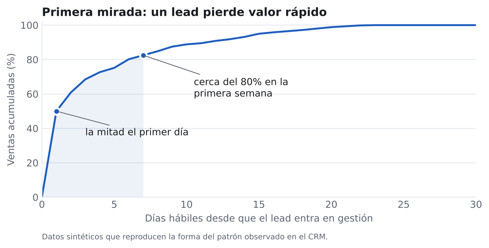
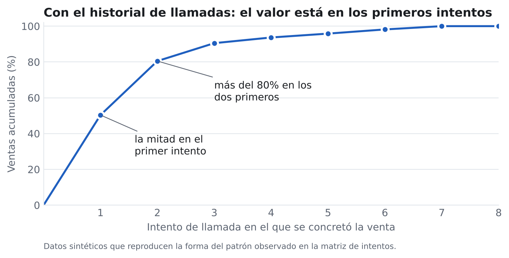
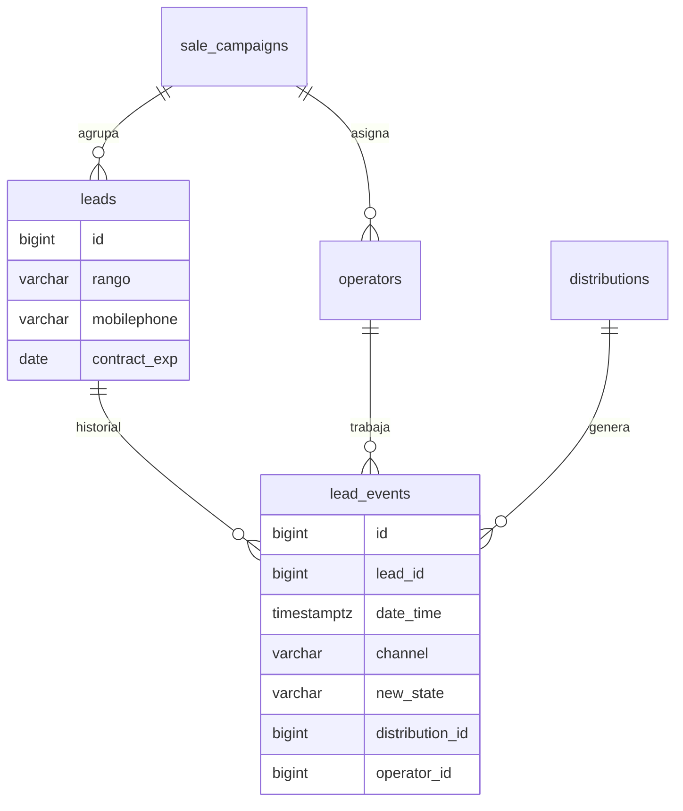
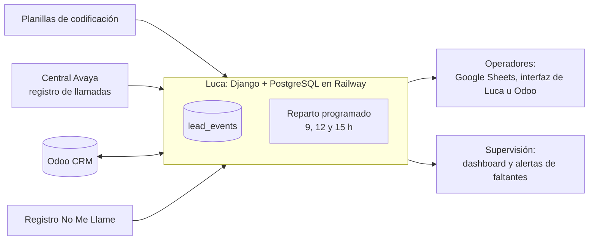

# Luca: distribución de leads en un call center

**Luca** es el sistema que decide a qué clientes llama cada operador en un call center de ventas telefónicas (agente oficial de Antel, ~15 operadores). Está en producción desde junio de 2026.

La idea que recorre este repositorio: **para automatizar una decisión, primero hay que poder verla en datos.** Antes de Luca, la información necesaria para repartir bien (a quién se llamó, cuántas veces, qué pasó) vivía en la memoria de un supervisor, repartida entre miles de leads. El modelo y la automatización vinieron después; el primer paso fue construir esa capa de información.

El código de producción es privado. No hay datos reales: las figuras usan datos sintéticos que reproducen la forma de los patrones observados.

---

## 1. Primera mirada: el CRM

**Cómo se trabajaba.** Cada día, el equipo administrativo armaba listas de clientes con contrato próximo a vencer, y un supervisor las repartía a mano entre los operadores. Cuando un cliente no atendía, el supervisor lo reasignaba a otro operador, uno por uno. Nadie sabía en tiempo real cuántos leads nuevos quedaban, así que los faltantes llegaban por sorpresa y los operadores terminaban recibiendo leads viejos.

El proyecto empezó como caso de estudio del Taller de Modelado Cuantitativo para Problemas de Producción (FING, Udelar, 2025). Entre noviembre y diciembre de 2025, la gerencia me dio acceso al CRM (Odoo). Grafiqué el porcentaje acumulado de ventas según los días hábiles que el lead llevaba en gestión:



La mitad de las ventas ocurre el primer día y cerca del 80% en la primera semana. Un lead pierde valor muy rápido. Con este resultado le propuse a la gerencia un algoritmo que eligiera qué leads llamar primero. Aceptaron, y me dieron acceso a la central telefónica (Avaya) y a las planillas de codificación.

---

## 2. La capa de información

**Lo que el CRM no tenía.** El CRM registra cada lead con su resultado final (vendido o no), pero no los intentos de llamada. Con eso solo se puede modelar *lead → resultado*.

Para enriquecerlo probé primero variables de localidad y nivel socioeconómico derivadas del prefijo telefónico. No agregaban señal.

**La fuga de información.** Como no tenía cuántas veces se había intentado cada lead, usé como sustituto los días en gestión (una variable que sugirió un asistente de IA). El modelo daba muy bien, pero la variable se medía hasta el resultado: un lead vendido el primer día tenía "1 día"; uno que nunca se vendió acumulaba semanas. El modelo aprendía "pocos días = venta" porque la variable ya contenía la respuesta, y en el momento de decidir ese dato todavía no existe. Una prueba de calibración lo delató: el modelo predecía muchas más ventas de las reales. La solución no fue ajustar el modelo; fue conseguir mejor información.

**La matriz de intentos.** Con los registros de llamadas de Avaya, las ventas de Odoo y las planillas de codificación reconstruí el historial de cada lead llamada por llamada. Normalicé teléfonos con formatos distintos, filtré contestadoras automáticas por su patrón de duración y atribuí cada venta a su intento. El modelo pasó de *lead → resultado* a *lead → intentos → resultado*, con una fila por intento. Eso tuvo dos efectos:

- **Muchas más observaciones.** Los intentos fallidos de un lead que después se vendió dejan de perderse.
- **Variables que solo miran el pasado.** En cada intento se sabe cuántos intentos sin respuesta lleva el lead, al que llamo **k**, y nada de lo que pasó después.

Con esa información apareció la misma curva, ahora en función de los intentos:



La mitad de las ventas se cierra en el primer intento, más del 80% en los dos primeros y casi todas antes del quinto. A diferencia de los días, que pasan solos, los intentos son algo que el sistema puede contar y sobre lo que puede decidir.

**De un análisis a un sistema.** La matriz de intentos la reconstruí una vez, a mano, desde exports. Para que esa información exista siempre, el sistema la registra mientras ocurre: cada cambio de estado de un lead (asignado, no contesta, agendado, venta…) es una fila nueva en `lead_events`, y nunca se sobrescribe.



El estado actual de un lead es su último evento, y cualquier momento pasado se puede reconstruir: por ejemplo, cuántos intentos llevaba un lead el día que se vendió. La alternativa es depender de lo que el supervisor recuerde sobre miles de leads.

Esquema (simplificado): [`sql/01_esquema.sql`](sql/01_esquema.sql).

---

## 3. De la información a la decisión

**El piloto.** Con 3 operadores, en abril y mayo de 2026, probé la primera versión, que implementé yo con PostgreSQL y Python. Tenía dos modelos XGBoost (probabilidad de que el cliente atienda y de que compre si atiende) y un modelo de tiempo esperado por lead para calcular cuántos leads entran en cada turno.

**El piloto cambió el problema.** El diseño suponía que sobraban leads y había que elegir los mejores; en las entrevistas con supervisión nadie había mencionado faltantes. El piloto mostró lo contrario: **faltaban leads**. Los nuevos se consumían en el mismo día, así que el orden fino casi no cambiaba el resultado. El orden importaba entre los leads viejos, y ahí pesaban k y si el cliente tenía celular. Además, el modelo era difícil de explicar a los operadores y no garantizaba que todos recibieran la misma cantidad de leads nuevos.

**La regla de ordenamiento en producción.** Para la línea de fibra:

1. menos intentos sin respuesta (k) primero;
2. con celular primero;
3. más cerca del vencimiento del contrato primero.

El reparto es round-robin entre los operadores del turno, sin repetir un lead al mismo operador en el día, con una cuota por operador acordada con supervisión. El modelo sirvió para entender el problema y elegir las variables; la regla es lo que corre todos los días.

---

## 4. De la decisión a la automatización



- **Cada mañana** el sistema filtra la base contra el registro legal No Me Llame.
- **En horarios fijos** reparte los leads según la regla.
- **Si el stock de leads frescos queda bajo,** avisa por WhatsApp, para que el faltante deje de llegar por sorpresa.
- **Los operadores** trabajan en Google Sheets, en la interfaz propia de Luca o en el CRM de Odoo (en piloto). Lo que marcan vuelve al sistema como eventos nuevos, y la capa de información se mantiene sola.

---

## 5. Consultas SQL

Una consulta por capa. Todas corren en PostgreSQL.

| Capa | Archivo | Pregunta que responde |
|---|---|---|
| Información | [`02_estado_actual.sql`](sql/02_estado_actual.sql) | ¿En qué estado está hoy cada lead? (`DISTINCT ON` sobre el log) |
| Análisis | [`03_ventas_por_intento.sql`](sql/03_ventas_por_intento.sql) | ¿En qué intento se cierran las ventas? (el segundo gráfico) |
| Decisión | [`04_cola_distribucion.sql`](sql/04_cola_distribucion.sql) | ¿En qué orden se reparten los leads disponibles? (la regla, en SQL) |
| Monitoreo | [`05_kpi_diario.sql`](sql/05_kpi_diario.sql) | Asignados, trabajados y k promedio por día |

La consulta de análisis pasa del log de eventos a la curva por intento, con funciones de ventana. Se cuentan solo los intentos anteriores a la venta: un lead puede volver al pool si la venta se cancela, y ser llamado más adelante.

```sql
k_previo AS (
    SELECT v.lead_id, COUNT(le.id) AS k
    FROM ventas v
    LEFT JOIN lead_events le
           ON le.lead_id   = v.lead_id
          AND le.channel   = 'call'
          AND le.new_state = 'no_contesta'
          AND le.date_time < v.venta_time      -- solo el pasado
    GROUP BY v.lead_id
)
SELECT k + 1 AS intento,
       COUNT(*) AS ventas,
       ROUND(100.0 * SUM(COUNT(*)) OVER (ORDER BY k)
                   / SUM(COUNT(*)) OVER (), 1) AS pct_acumulado
FROM k_previo
GROUP BY k
ORDER BY intento;
```

---

## 6. Roles

| Etapa | Quién |
|---|---|
| Análisis de datos, matriz de intentos, modelos y regla de distribución | Mateo Soldini |
| Modelo de datos (`lead_events`) y piloto completo: PostgreSQL, tareas programadas, dashboard en Streamlit (abril 2026) | Mateo Soldini |
| Aplicación de producción en Django, despliegue e integraciones (desarrollo desde mayo; en producción desde junio de 2026) | Pedro y João Calado, con mis especificaciones |
| Consultas de análisis y KPIs sobre producción | Mateo Soldini |

---

## 7. Lo que aprendí

- **La información va primero.** Ni el modelo ni la automatización funcionaban sin el historial de intentos. El trabajo de más valor fue construir esa capa.
- **Medir antes de diseñar.** Las entrevistas no mostraron que faltaban leads; comparar los leads que entraban con los que se consumían por día lo habría mostrado en una tarde.
- **La IA propone y la auditoría valida.** La variable con fuga la sugirió un asistente de IA, y el modelo "funcionaba". La detectó una prueba de calibración.
- **El modelo informa y la regla opera.** En producción, una regla que los supervisores entienden y controlan vale más que un ranking opaco.

---

## Contenido

```
sql/        esquema y consultas (PostgreSQL)
scripts/    generación de las figuras con datos sintéticos
figures/    figuras del README
```

**Próximamente** (datos sintéticos):

- `notebooks/01_matriz_intentos.ipynb`: de los registros de llamadas a una fila por intento.
- `notebooks/02_modelos.ipynb`: XGBoost, calibración y la fuga de información.
